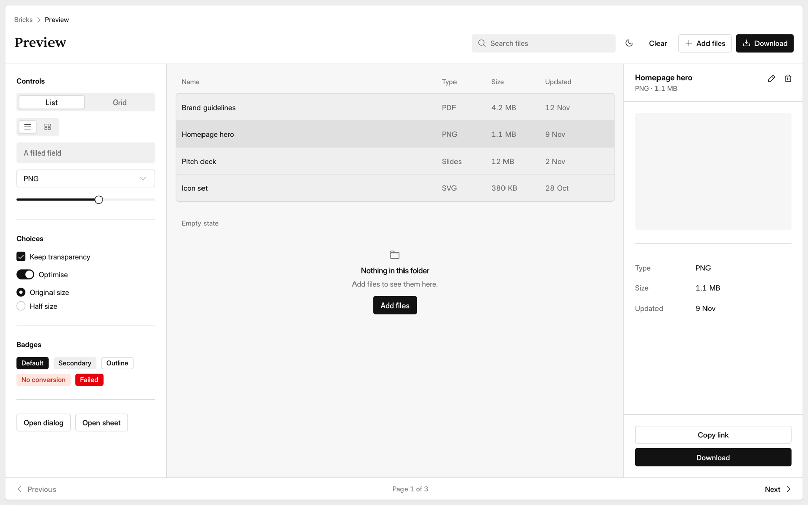
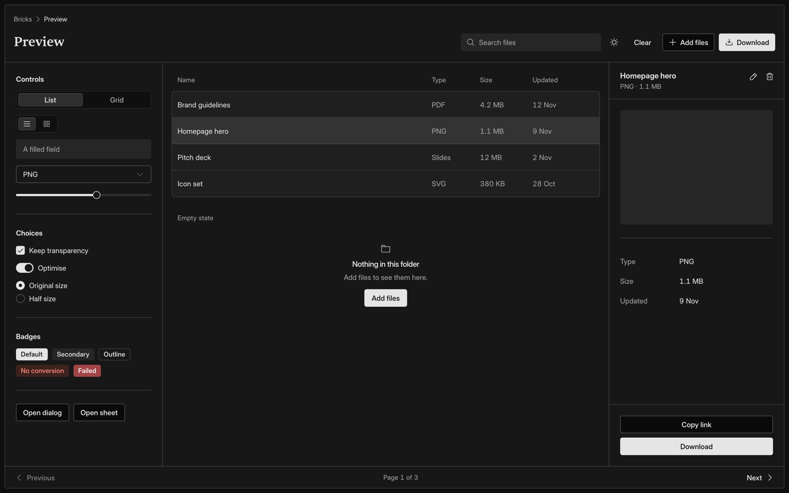

# Bricks

Shoreditch Design's UI library. shadcn/ui under the hood, our tokens on top: quiet monochrome surfaces, one 4px radius, one 32px control height, Inter for the UI and Sentient for display, in light and dark.

One source, three ways to use it:

1. **A shadcn registry.** `npx shadcn add` a component and you get our version of it, styled and wired to the tokens.
2. **A CSS tokens file.** `bricks.css` on its own: Tailwind v4 `@theme`, light and dark variables, and a few scoped rules. Works from a CDN with no build step.
3. **Docs for humans and Claude.** [`DESIGN.md`](DESIGN.md) holds the rules (tokens, type, spacing, buttons, panels, rows, states). [`skills/bricks/SKILL.md`](skills/bricks/SKILL.md) teaches Claude to build with Bricks.




## Install with the shadcn registry

You need a React project with Tailwind CSS v4 and shadcn set up (`npx shadcn@latest init`; any preset is fine, Bricks overrides the theme).

Add the base item. It brings the tokens, the `cn()` helper and the core components (button, input, badge, segmented control, dialog, sheet, empty, separator, tooltip, skeleton):

```bash
npx shadcn@latest add https://raw.githubusercontent.com/ShoreditchDesignStudio/bricks/main/public/r/bricks.json --overwrite
```

`--overwrite` replaces shadcn's stock `lib/utils.ts` with ours (it teaches tailwind-merge the Bricks type sizes) and any stock components you already have with ours.

Then add anything else by name:

```bash
npx shadcn@latest add https://raw.githubusercontent.com/ShoreditchDesignStudio/bricks/main/public/r/data-rows.json
```

Or register the namespace once in `components.json`:

```json
{
  "registries": {
    "@bricks": "https://raw.githubusercontent.com/ShoreditchDesignStudio/bricks/main/public/r/{name}.json"
  }
}
```

and then:

```bash
npx shadcn@latest add @bricks/select @bricks/detail-panel @bricks/state-message
```

Every component depends on the `theme` and `utils` items, so adding any one of them on its own still gives you the full token set.

### What's in the registry

| Item | Type | What it is |
| --- | --- | --- |
| `bricks` | style | The base: theme, utils and the core components |
| `theme` | theme | Every token as `cssVars` (light, dark, `@theme`), plus the base and scoped rules |
| `utils` | lib | `cn()` with tailwind-merge taught the Bricks type sizes |
| `button`, `input`, `badge`, `toggle`, `toggle-group`, `dialog`, `sheet`, `empty`, `alert`, `card`, `checkbox`, `switch`, `radio-group`, `select`, `slider`, `popover`, `dropdown-menu`, `tooltip`, `avatar`, `breadcrumb`, `separator`, `skeleton`, `scroll-area`, `collapsible`, `sonner` | ui | shadcn's primitives on Bricks tokens |
| `page-header`, `page-footer`, `detail-panel`, `info-blocks`, `data-rows`, `state-message` | component | The layout parts: header, pagination footer, 320px details panel, panel spacing, row groups, empty and error states |

The full list, with descriptions, is in [`registry.json`](registry.json).

### Pinning a version

`main` always serves the latest build. To pin, swap `main` for a tag in the URL you add from (for example `.../bricks/v0.1.0/public/r/button.json`). Items point at their own dependencies on `main`, so a pinned item can still pull a newer `theme` or `utils`; re-run `add` with `--overwrite` when you upgrade.

## Use the CSS on its own

### In a Tailwind v4 project

Copy `bricks.css` into your project (or install the package once it's published) and import it after Tailwind:

```css
@import "tailwindcss";
@import "tw-animate-css"; /* optional: dialog, sheet and menu motion */
@import "./bricks.css";
```

You get every Bricks utility (`bg-primary-hover`, `bg-listing`, `text-panel-title`, `rounded-row-group`, `shadow-toast` and the rest) and the dark theme on `.dark`.

### From a CDN, with no build step

jsDelivr serves files straight from this GitHub repo. Pin a tag:

```html
<!-- Tailwind's browser build, then Bricks. bricks.js adds bricks.css as a Tailwind stylesheet (with Tailwind's own import) and links the fonts. -->
<script src="https://cdn.jsdelivr.net/npm/@tailwindcss/browser@4.3.5"></script>
<script src="https://cdn.jsdelivr.net/gh/ShoreditchDesignStudio/bricks@v0.1.0/bricks.js"></script>
```

That's what a Claude.ai artifact or a CodePen should use. Write Tailwind classes against the Bricks tokens as usual. Don't add your own `@import "tailwindcss"`; `bricks.js` already does. Add `data-fonts="none"` to the script tag to skip the font links.

Without Tailwind at all, link the CSS file. The browser ignores the `@theme` blocks and keeps the variables, the base type and colours, and the scoped rules, so `var(--primary)`, `var(--radius)` and friends work in your own CSS:

```html
<link rel="stylesheet" href="https://cdn.jsdelivr.net/gh/ShoreditchDesignStudio/bricks@v0.1.0/bricks.css" />
```

**jsDelivr limits worth knowing:**

- Only public repos, and files up to 20 MB (Bricks' files are under 20 KB).
- **Pin a tag (`@v0.1.0`) or a commit, not a branch.** Branch URLs (`@main`) are cached for up to 12 hours, so a push won’t show straight away. Tagged files are cached for good. Leaving the version out serves the newest tag.
- A stale branch URL can be purged at `https://purge.jsdelivr.net/gh/ShoreditchDesignStudio/bricks@main/bricks.css`.
- jsDelivr is a free public CDN with no SLA. For production, self-host the file or install the package.
- Tailwind's browser build compiles in the page. It's fine for prototypes and artifacts, not for production.

## Fonts

Bricks names two families and bundles neither.

**Inter** (SIL Open Font License 1.1), for the UI. Load the variable file with the optical-size axis; Bricks forces the display cut with `font-variation-settings: "opsz" 32`.

- Next.js: `next/font/google` with `Inter({ subsets: ["latin"], axes: ["opsz"], variable: "--font-inter" })`, and put `inter.variable` on `<html>`. Bricks reads `--font-inter` first.
- Anywhere else: `<link rel="stylesheet" href="https://fonts.googleapis.com/css2?family=Inter:opsz,wght@14..32,100..900&display=swap">`.

**Sentient** (Fontshare, ITF Free Font License), for display (`font-display`: page titles, illustrated states). Link Fontshare's hosted CSS; don't commit or redistribute the font files.

```html
<link rel="preconnect" href="https://api.fontshare.com" />
<link rel="preconnect" href="https://cdn.fontshare.com" crossorigin />
<link rel="stylesheet" href="https://api.fontshare.com/v2/css?f[]=sentient@400,500&display=swap" />
```

Without the fonts, Bricks falls back to the system UI face and Georgia.

## Theming

- **Dark mode** is a `dark` class on `<html>`. Set it in a tiny inline script before first paint to avoid a flash, or use `next-themes` with `attribute="class"`.
- **Reskinning** means changing values in `:root` and `.dark`, never component code. Start with the base palette (`--ground`, `--surface`, `--nested`, `--row`, `--ink`, `--ink-secondary`, `--hairline`) and the semantic names follow.
- **New colours** become tokens, with a light and a dark value, mapped in `@theme inline` so they get a utility.
- The token roles and the rules for each are in [`DESIGN.md`](DESIGN.md).

## Develop

```bash
npm install
npm run build        # bricks.css -> registry.json -> public/r/*.json, and bricks.js
npm run typecheck
npm run build:local  # a copy of the registry pointing at http://localhost:4455/r, in .local/
```

- `bricks.css` is the single source for tokens. `scripts/build.mjs` reads it into the `theme` item and reads each component's imports to fill in its dependencies, so nothing is listed twice.
- Components live in `registry/bricks/ui` (primitives) and `registry/bricks/blocks` (layout parts), importing each other as `@/registry/bricks/...`; the shadcn CLI rewrites those to the consumer's aliases.
- The registry is built with `shadcn@4.23.0` (pinned in `devDependencies`).
- `BRICKS_URL` sets where the registry is served if you host it somewhere other than this repo's `main` branch (for example GitHub Pages or Vercel).

### Preview

`preview/` is a small Vite app that installs every item from the built registry, the same way a consumer would, and shows them in light and dark:

```bash
cd preview
npm install
npm run sync   # builds the local registry and runs shadcn add for every item
npm run dev    # ?theme=dark, ?dialog and ?sheet open those states directly
```

## Licence

MIT. Bricks' components are adapted from [shadcn/ui](https://ui.shadcn.com) (MIT); both notices are in [`LICENSE`](LICENSE). Fonts aren't included and keep their own licences.
